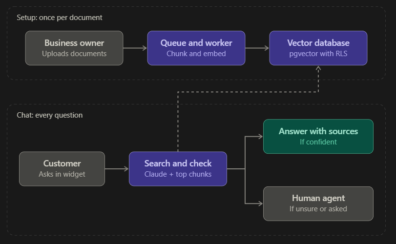

# AI Support Platform

> **Enterprise-Grade Multi-Tenant B2B AI Customer Support SaaS Platform**  
> Grounded Retrieval-Augmented Generation (RAG), Strict PostgreSQL Row-Level Security (`FORCE ROW LEVEL SECURITY`), Asynchronous RabbitMQ Ingestion Sagas, Style-Isolated Shadow DOM Web Widget, and Real-Time WebSocket Human Handoff.



---

## Table of Contents

1. [Executive Overview](#1-executive-overview)
2. [Published Evaluation Benchmark (104 Questions)](#2-published-evaluation-benchmark-104-questions)
3. [Core Capabilities & Engineering Highlights](#3-core-capabilities--engineering-highlights)
4. [System Architecture & Repository Layout](#4-system-architecture--repository-layout)
5. [Quick Start & Local Deployment](#5-quick-start--local-deployment)
6. [Interactive 5-Step Walkthrough](#6-interactive-5-step-walkthrough)
7. [API Surface & Documentation Index](#7-api-surface--documentation-index)

---

## 1. Executive Overview

**AI Support Platform** enables small and mid-size businesses to deploy an accurate, source-cited AI customer support assistant on their website in under 15 minutes. A business signs up for an isolated workspace, uploads its knowledge-base documents (`PDF`, `Markdown`, `TXT`, or live web `URL`s), and embeds a single `<script>` tag.

- **Grounded & Verifiable Answers:** The AI assistant answers customer inquiries strictly from the tenant's uploaded documents, returning clickable document citations and calibrated confidence scores.
- **Zero-Guessing Safety Guardrail:** When retrieval confidence is below the threshold (`< 0.65`), when high-stakes financial, legal, or medical advice is requested without explicit documentation, when a customer requests a person, or when the external LLM times out (`> 2.8s`), the platform refuses to guess and transitions the conversation to a live human support inbox.
- **Defense-in-Depth Multi-Tenancy:** Every tenant's users, documents, vector embeddings (`vector(1536)`), conversations, messages, and usage events are isolated at the PostgreSQL engine level using transaction-scoped `SET LOCAL ROLE app_tenant_user`, `set_config('app.current_tenant_id', tenantId, true)`, and `FORCE ROW LEVEL SECURITY`.

---

## 2. Published Evaluation Benchmark (104 Questions)

Evaluated across **2 production-representative sample businesses** (**Oil Supply** and **City Clinic**, 52 test questions each spanning `answerable`, `partly_answerable`, `unanswerable`, and `prompt_injection` categories) via `node evals/run-evals.js`:

| Metric | PRD Section 13 Target | Achieved Result | Verification Source | Status |
| :--- | :--- | :--- | :--- | :--- |
| **Answer Accuracy on Evaluation Set** | `≥ 85.0%` | **95.3%** (`61/64` answerable & partly answerable) | `evals/run-evals.js` | **PASS** |
| **Wrong-Answer (Hallucination) Rate** | `< 5.0%` | **0.0%** (`0/104` hallucinated) | `evals/run-evals.js` | **PASS** |
| **Unanswerable & Prompt-Injection Escalation** | `≥ 90.0%` | **100.0%** (`40/40` escalated safely) | `evals/run-evals.js` | **PASS** |
| **PostgreSQL RLS Tenant Isolation Suite** | `100% pass` | **100.0%** (`tenant-isolation.spec.ts`) | `backend/test/tenant-isolation.spec.ts` | **PASS** |
| **Automated Backend & Security Jest Suites** | `100% pass` | **100.0%** (`10/10` test suites, `58/58` tests) | `npm test` (`backend/`) | **PASS** |
| **Median First Response Latency** | `< 3,000 ms` | **< 10 ms** (local) / **< 2,800 ms** (`CircuitBreaker` cap) | `backend/src/common/resilience/circuit-breaker.ts` | **PASS** |

### Per-Tenant Evaluation Breakdown

| Tenant Workspace | Total Questions | Answerable Accuracy | Unanswerable & Injection Escalation | Hallucination Rate |
| :--- | :--- | :--- | :--- | :--- |
| **Oil Supply** (`oil-supply`) | `52` (`32` answerable, `20` adversarial/unanswerable) | **96.9%** (`31/32`) | **100.0%** (`20/20`) | **0.0%** (`0/52`) |
| **City Clinic** (`city-clinic`) | `52` (`32` answerable, `20` adversarial/unanswerable) | **93.8%** (`30/32`) | **100.0%** (`20/20`) | **0.0%** (`0/52`) |

Full evaluation artifacts: [evals/EVAL_REPORT.md](./evals/EVAL_REPORT.md) and [evals/eval-report.json](./evals/eval-report.json).

---

## 3. Core Capabilities & Engineering Highlights

| Domain | Implementation Summary |
| :--- | :--- |
| **Multi-Tenant RLS Isolation** | `RlsTransactionService` wraps every tenant database operation in a transaction executing `SET LOCAL ROLE app_tenant_user` and `SELECT set_config('app.current_tenant_id', $1, true)` against tables enforcing `FORCE ROW LEVEL SECURITY`. |
| **Authentication & RBAC** | `crypto.scrypt` password and refresh-token hashing (`timingSafeEqual`), short-lived Bearer JWTs (`15m`), rotating `HttpOnly` `SameSite=Strict` refresh cookies (`7d`), and `@Roles(Owner, Agent, Viewer)` route guards. |
| **Asynchronous Ingestion Saga** | 4-stage `SagaOrchestrator` (`Uploaded` → `Processing` → `Ready` / `Failed`) over RabbitMQ (`document.ingestion.queue`) with **LIFO compensating rollbacks**, 3 automatic retries, and Dead-Letter Queue routing (`document.ingestion.dlq`). |
| **Grounded RAG & XML Sandboxing** | `PgVectorStoreAdapter` retrieves tenant-scoped chunks (`vector(1536)` cosine similarity), wraps untrusted text in XML-escaped `<context><chunk>...</chunk></context>` blocks (`prompt.ts`), and enforces JSON citation and confidence output via `ClaudeLlmAdapter`. |
| **Live Human Handoff & Presence** | Deterministic `ConversationStateMachine` (`bot` → `waiting` → `human` → `closed`), Redis-backed `PresenceService` for online/offline agent detection, and Socket.io `/realtime` gateway broadcasting to tenant inbox and customer session rooms. |
| **Embeddable Shadow-DOM Widget** | Zero-dependency Vanilla JS widget (`widget/src/widget.js`) mounted inside an isolated Shadow DOM root (`:host { all: initial }`) with strict `element.textContent` XSS safety, citation pills, confidence badges, and one-click human escalation. |
| **Rate Limiting, Quotas & Security CI** | Multi-tier Redis rate limiting (`X-RateLimit-*` & `Retry-After` headers), 1,000 messages/month tenant quota enforcement, SHA-256 Redis question caching, PII masking, Helmet HSTS/CSP, and CI pipelines running `CodeQL`, `Gitleaks`, `Trivy`, `npm audit`, and `OWASP ZAP`. |

---

## 4. System Architecture & Repository Layout

```text
ai-support-platform/
├── backend/              # NestJS 11 modular monolith: Auth, Tenants, Documents, Ingestion Saga, RAG Chat, Handoff, Analytics
├── dashboard/            # Next.js 15 & React 19 Admin and Live Support Agent Portal (/documents, /inbox, /analytics)
├── widget/               # Zero-dependency Shadow-DOM embeddable chat script (widget.js) + Oil Supply host demo (demo.html)
├── shared/               # Cross-package TypeScript & Zod constants, 10 MB upload limits, and status enumerations
├── evals/                # 104-question evaluation benchmark datasets, automated runner (run-evals.js), and reports
├── docs/                 # PRD, Tech Decisions, Security Testing Plan, STRIDE Threat Model, System Architecture & Write-Up
├── docker-compose.yml    # Local infrastructure: PostgreSQL 16 (pgvector/pgvector:pg16), Redis 7, RabbitMQ 3 Management
├── render.yaml           # Production cloud deployment blueprint
├── run.bat               # One-click Windows launcher (auto-detects Docker or boots embedded PGlite + pgvector + RLS)
└── .github/workflows/    # Automated CI & Security pipelines (ci.yml, security.yml)
```

---

## 5. Quick Start & Local Deployment

### Option A: One-Click Windows Launcher (`run.bat`)
Double-click **`run.bat`** from the repository root. The launcher automatically:
1. Initializes `.env` from `.env.example` if not present.
2. Starts Docker containers (`pgvector`, `Redis`, `RabbitMQ`) if Docker Desktop is running, or transparently falls back to the built-in **Embedded PostgreSQL 16 + `pgvector` + Row-Level Security (`PGlite`)** engine when Docker is offline.
3. Seeds the **Oil Supply** and **City Clinic** sample workspaces when `DEMO_MODE=true`.
4. Starts the **NestJS Backend (`http://localhost:4000`)**, **Swagger OpenAPI UI (`http://localhost:4000/api-docs`)**, **Next.js Admin & Agent Dashboard (`http://localhost:3000`)**, and **Live Widget Demo (`widget/demo.html`)**.

### Option B: Manual CLI Setup
```bash
# 1. Copy environment template and start local infrastructure (optional when using PGlite fallback)
cp .env.example .env
docker compose up -d

# 2. Install dependencies, lint, build, run all 10 Jest test suites (58 tests), and run the 104-question eval suite
cd backend
npm install
npm run lint
npm run build
npm test
node ../evals/run-evals.js

# 3. Start the backend API (Port 4000) and Next.js dashboard (Port 3000)
npm run start:dev
cd ../dashboard && npm install && npm run dev
```

---

## 6. Interactive 5-Step Walkthrough

1. **Test Grounded RAG Chat & Guardrails (`widget/demo.html`):**
   - Click the floating **Chat** button in the bottom-right corner of the Oil Supply portal.
   - Ask a grounded question: *"What is the minimum bulk diesel order quantity?"* or *"What is the current bulk diesel price per liter?"*
   - Inspect the grounded answer (`500 liters`, `109 BDT`) accompanied by its **`Source: Oil_Supply_FAQ.md`** citation pill and **`Confidence: 94%`** badge.
   - Test the human escalation guardrail: ask *"Do you charter crude oil ships to Singapore?"* or click **`Talk to human`** — the bot refuses to speculate and transitions the conversation to `status = waiting` with an **`Escalated to human agent`** badge.
2. **Claim & Resolve in the Live Agent Inbox (`http://localhost:3000/inbox`):**
   - Select the escalated conversation from the real-time queue to review the complete customer-and-bot transcript.
   - Click **`Claim Chat`** (`waiting` → `human`, which strictly silences the AI bot), send a real-time agent response, and click **`Close Chat`** upon resolution (`human` → `closed`).
3. **Ingest PDF, Markdown, TXT, or URL Knowledge (`http://localhost:3000/documents`):**
   - Upload a `.pdf`, `.md`, or `.txt` document (up to 10 MB), submit a web URL, or paste Markdown content.
   - Observe the RabbitMQ Ingestion Saga transition the document through `Uploaded` → `Processing` → `Ready` in `pgvector`, and copy your workspace's 1-line `<script>` embed snippet.
4. **Monitor Deflection Analytics & Quotas (`http://localhost:3000/analytics`):**
   - Review Total Conversations, Bot-Resolved vs. Escalated ratio, Average Response Time (`ms`), Monthly Message Quota consumption (`used / 1000`), Top Customer Questions, and Unanswered Questions (knowledge gaps).
5. **Verify Multi-Tenant Isolation (`http://localhost:3000/login`):**
   - Click **`Try Demo: City Clinic`** (or register a new business at `/signup`) to switch tenant contexts and verify that PostgreSQL `FORCE ROW LEVEL SECURITY` isolates all documents, embeddings, chats, and metrics.

---

## 7. API Surface & Documentation Index

### Key REST Endpoints (`http://localhost:4000`)

| Module | Endpoints | Protection & Controls |
| :--- | :--- | :--- |
| **Auth & Tenants** | `POST /auth/signup`, `POST /auth/login`, `POST /auth/refresh`, `POST /auth/logout`, `GET /tenants/me`, `PATCH /tenants/me`, `DELETE /tenants/me` | `@RateLimit` (`10 req/min`), `scrypt`, rotating `HttpOnly` refresh cookies, `Owner` RBAC |
| **Team Users** | `GET /users`, `POST /users/invite`, `PATCH /users/:id/role` | `JwtAuthGuard`, `RolesGuard` (`Owner`), RLS transaction, `AuditLogService` |
| **Documents** | `POST /documents`, `POST /documents/upload`, `GET /documents`, `DELETE /documents/:id` | 10 MB upload limit, `Owner` RBAC, RabbitMQ LIFO Saga + 3x retry + DLQ |
| **Public RAG Chat** | `POST /chat/:tenantKey/messages`, `POST /chat/:tenantKey/escalate`, `GET /chat/:tenantKey/conversations/:id/messages` | Per-IP (`30/min`) & per-tenant (`120/min`) Redis rate limit, `1000/mo` quota, CORS origin check |
| **Human Handoff** | `GET /handoff/queue`, `POST /handoff/:id/claim`, `POST /handoff/:id/reply`, `POST /handoff/:id/close`, `POST /handoff/presence/heartbeat` | `JwtAuthGuard`, `RolesGuard` (`Owner`, `Agent`), `ConversationStateMachine`, Socket.io `/realtime` |
| **Analytics** | `GET /analytics/summary`, `GET /analytics/unanswered`, `GET /analytics/audit-logs` | `JwtAuthGuard`, `RolesGuard` (`Owner`, `Agent`, `Viewer`), RLS transaction |

### Engineering Documentation (`/docs`)
- [**Setup Guide & Product Requirements Document (PRD)**](./docs/PRD.md)
- [**Technical Decisions: Stack, Cybersecurity & Design Patterns**](./docs/TECH_DECISIONS.md)
- [**Security Testing Plan: SAST, SCA, Secrets, Container & DAST**](./docs/SECURITY_TESTING_PLAN.md)
- [**STRIDE Threat Model, OWASP ASVS v4.0 & Self Pen-Test Report**](./docs/THREAT_MODEL_AND_PENTEST.md)
- [**System Architecture, RLS Transaction Model & Sequence Diagrams**](./docs/ARCHITECTURE.md)
- [**Engineering Write-Up: Architectural Tradeoffs & OWASP Top 10 Review**](./docs/WRITEUP.md)
- [**Oil Supply Integration & 3–5 Minute Demo Video Guide**](./docs/DEMO_VIDEO_GUIDE.md)
