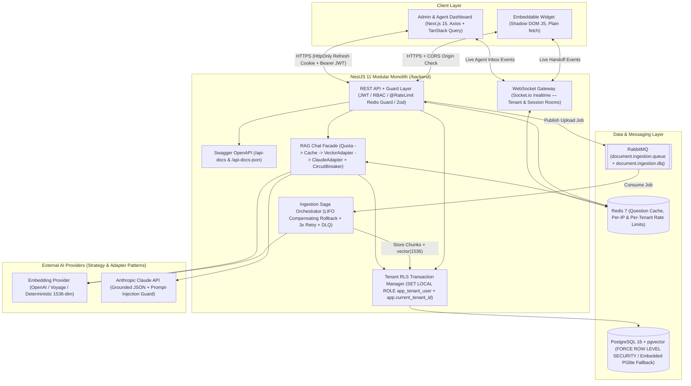
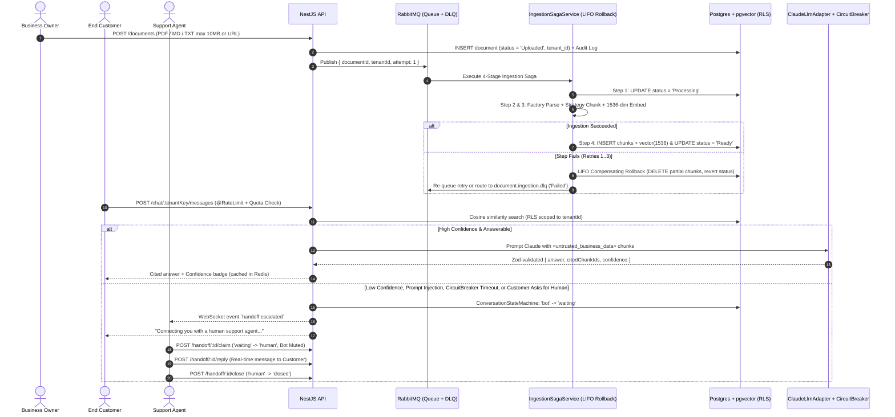

# AI Support Platform — System Architecture

## 1. High-Level System Architecture



---

## 2. Multi-Tenant Row-Level Security (RLS) Isolation Model

A critical risk when combining PostgreSQL RLS with ORMs like TypeORM is **connection pooling leakage**: if `SET app.current_tenant_id` is executed at the session level, a pooled connection returned to the pool retains the previous tenant's ID. Furthermore, if the app connects as the `postgres` superuser, PostgreSQL bypasses RLS policies altogether.

To eliminate both risks completely:
1. **Non-Superuser Role + Transaction-Local Context (`SET LOCAL`):** Every tenant-scoped operation in `RlsTransactionService` executes inside a database transaction that immediately runs:
   ```sql
   SET LOCAL ROLE app_tenant_user;
   SELECT set_config('app.current_tenant_id', $1, true);
   ```
   Because the third argument `is_local` is `true`, PostgreSQL automatically clears the tenant ID and role the instant the transaction commits or rolls back.
2. **`FORCE ROW LEVEL SECURITY`:** All 6 tenant-scoped tables (`users`, `documents`, `chunks`, `conversations`, `messages`, `usage_events`) enable both `ENABLE ROW LEVEL SECURITY` and `FORCE ROW LEVEL SECURITY` with policies checking:
   ```sql
   tenant_id = NULLIF(current_setting('app.current_tenant_id', true), '')::uuid
   ```
   If any code path forgets to set the tenant context, queries fail closed (returning `0` rows or rejecting inserts) rather than leaking data across tenants.

---

## 3. Document Ingestion Saga & RAG Escalation Flow


