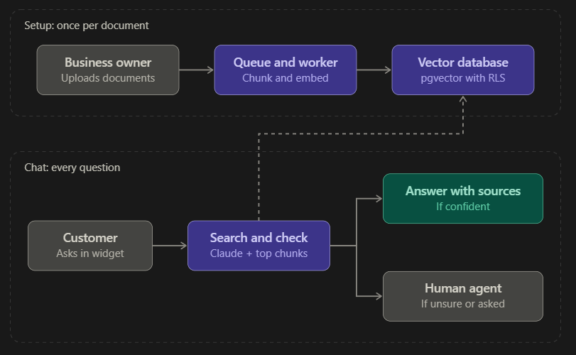
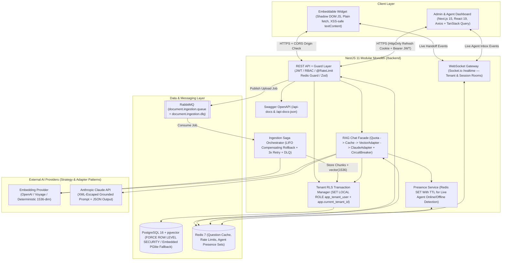

# AI Support Platform — System Architecture & Data Flow Specification

> **Architectural Blueprint, Multi-Tenant Row-Level Security (RLS) Transaction Model, and Asynchronous Saga Sequences**

---

## 0. End-to-End Flow at a Glance



- **Setup Phase (Once per Document):** `Business owner (Uploads documents)` → `Queue and worker (Chunk and embed)` → `Vector database (pgvector with RLS)`
- **Runtime Chat Phase (Every Customer Question):** `Customer (Asks in widget)` → `Search and check (Claude + top chunks from pgvector with RLS)` → branches deterministically into:
  1. **`Answer with sources (If confident)`** — Grounded response with document citation pills and confidence percentage.
  2. **`Human agent (If unsure or asked)`** — Automatic state transition (`bot` → `waiting`) and real-time WebSocket dispatch to the live agent inbox.

---

## 1. High-Level System Architecture



---

## 2. Multi-Tenant Row-Level Security (RLS) Isolation Model

A well-known vulnerability when combining PostgreSQL Row-Level Security with connection-pooled ORMs (such as TypeORM) is **session state bleeding**: if `SET app.current_tenant_id` is executed at the session level, a pooled connection returned to the pool retains the previous tenant's context. Additionally, if the application connects as the `postgres` superuser, PostgreSQL bypasses RLS policies altogether.

To eliminate both failure modes by construction:

1. **Non-Superuser Role + Transaction-Local Context (`SET LOCAL`):** Every tenant-scoped database operation in `RlsTransactionService` runs inside an explicit database transaction that immediately executes:
   ```sql
   SET LOCAL ROLE app_tenant_user;
   SELECT set_config('app.current_tenant_id', $1, true);
   ```
   Because the third argument `is_local` is `true`, PostgreSQL automatically resets both the role and `app.current_tenant_id` the instant the transaction commits or rolls back.
2. **`FORCE ROW LEVEL SECURITY` Across All Tenant Tables:** All 6 tenant-scoped tables (`users`, `documents`, `chunks`, `conversations`, `messages`, `usage_events`) enable both `ENABLE ROW LEVEL SECURITY` and `FORCE ROW LEVEL SECURITY` with policies enforcing:
   ```sql
   tenant_id = NULLIF(current_setting('app.current_tenant_id', true), '')::uuid
   ```
   If any code path omits the tenant context, queries fail closed (returning `0` rows or rejecting writes) rather than leaking data across tenants.

---

## 3. Document Ingestion Saga & RAG Escalation Sequence


---

## 4. Conversation Lifecycle State Machine

| Current State | Trigger / Action | Next State | AI Bot Behavior |
| :--- | :--- | :--- | :--- |
| **`bot`** | High-confidence answer (`≥ 0.65`) | **`bot`** | Active — answers from tenant chunks with source citations. |
| **`bot`** | Low confidence (`< 0.65`), prompt injection, customer asks for human, or LLM timeout | **`waiting`** | Paused — notifies agent inbox via WebSocket (`handoff:escalated`). |
| **`waiting`** | Support Agent clicks **`Claim Chat`** (`POST /handoff/:id/claim`) | **`human`** | Strictly muted — all subsequent messages route solely to the human agent. |
| **`human`** | Support Agent clicks **`Close Chat`** (`POST /handoff/:id/close`) | **`closed`** | Conversation archived; resolution metrics recorded in `/analytics`. |
